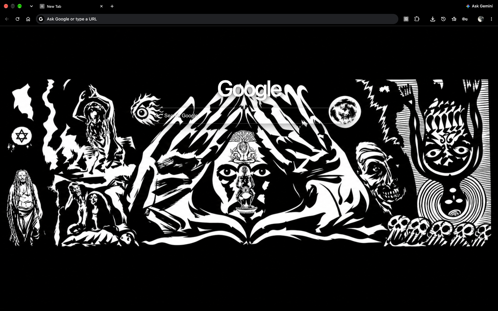
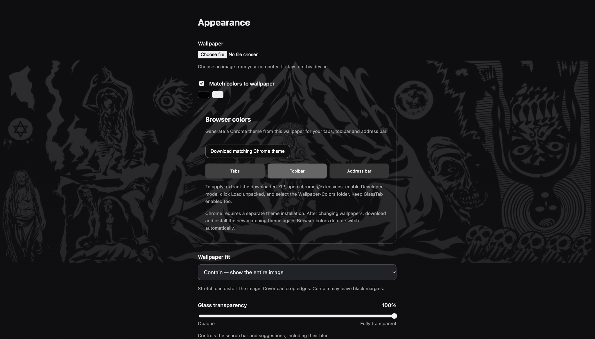
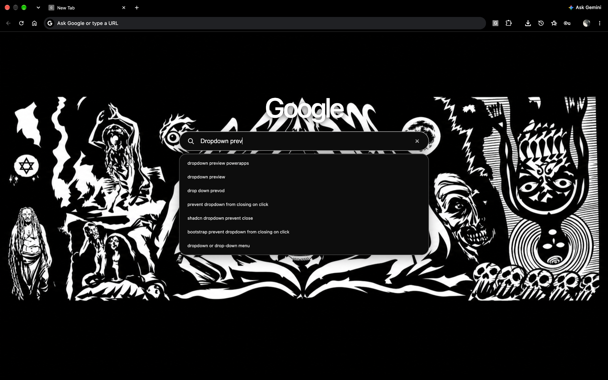
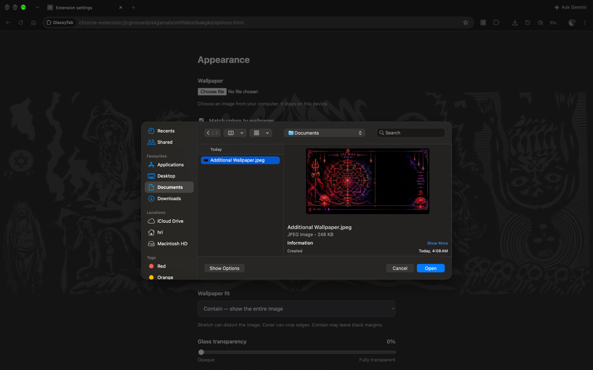
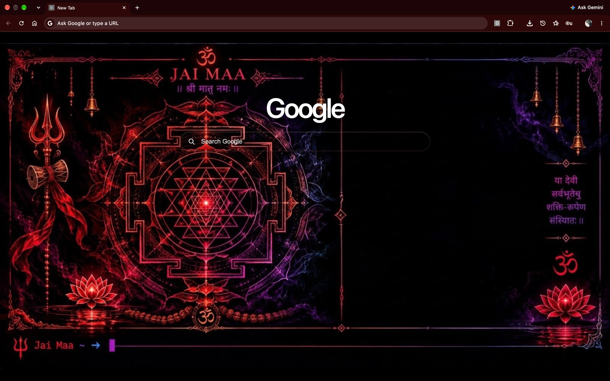

# GlassyTab

A minimal Chrome new tab with your wallpaper, a glass search bar, and colors drawn from your image.

**Version 0.4.2** · Manifest V3 · Plain JavaScript, HTML and CSS · No build step

## Screenshots

Real screenshots of GlassyTab running in desktop Google Chrome on macOS (captured November 4, 2026). Appearance depends on the selected wallpaper, transparency and separately installed Chrome theme.

### New tab · monochrome wallpaper

### Appearance settings

### Google search suggestions

### Wallpaper selection

### Custom wallpaper and matching browser theme

> The browser toolbar theme is a separate installable Chrome theme exported by GlassyTab. The new-tab wallpaper and search interface belong to the extension itself.

## Features

- Google search with suggestions and keyboard navigation.
- Local wallpaper uploads: PNG, JPEG, WebP and AVIF, up to **25 MiB** (26,214,400 bytes).
- Stretch, cover and contain wallpaper modes.
- Glass transparency from opaque to fully transparent, including adjustable blur.
- Wallpaper-derived glass and accent colors.
- Export a matching Chrome browser theme for tabs, toolbar and address bar.
- Settings kept separate from the new-tab page.

## Install

1. Download this repository using **Code → Download ZIP**, or clone it.
2. Extract the ZIP into a permanent folder. Keep the extension files there while using GlassyTab.
3. Open `chrome://extensions` in Chrome.
4. Turn on **Developer mode**.
5. Click **Load unpacked** and select the folder containing GlassyTab's `manifest.json`.
6. Open a new tab. If Chrome asks whether to keep the new-tab change, keep it.

The repository is the extension: there is no package manager, compilation step or paid API key.

## Open settings

Go to `chrome://extensions` → **GlassyTab → Details → Extension options**.

| Setting | What it does |
| --- | --- |
| Wallpaper | Upload an image stored on this device. Choose another file whenever you want to replace it. |
| Match colors to wallpaper | Adapt GlassyTab's glass and accents to the image. |
| Wallpaper fit | Stretch fills without cropping but may distort; cover preserves proportions but may crop; contain shows the entire image with margins. |
| Glass transparency | Adjust the search bar and suggestions from 0% (opaque) to 100% (transparent). Blur decreases with opacity. |
| Download matching Chrome theme | Generate a separate browser theme from the wallpaper's palette. |

**Wallpaper limit:** files larger than 25 MiB are rejected. A 30 MB+ file must be resized or compressed before upload. Restore original wallpaper is not included in this release.

## Match Chrome's tabs and toolbar

GlassyTab colors update inside the new-tab page automatically. Chrome's browser colors require a separate theme installation.

1. Choose a wallpaper in GlassyTab settings.
2. Click **Download matching Chrome theme**.
3. Extract `Wallpaper-Colors.zip` into a permanent folder.
4. Open `chrome://extensions`, enable Developer mode and click **Load unpacked**.
5. Select the extracted `Wallpaper-Colors` folder containing its `manifest.json`.
6. Keep the GlassyTab extension enabled alongside the theme.

The theme uses wallpaper-derived colors for the browser frame, toolbar and address field, with contrasting text. Exact rendering can vary by Chrome version and operating system.

After changing your wallpaper, download and apply the new matching theme again. **GlassyTab does not automatically install or switch Chrome browser themes.** To remove the theme, open `chrome://settings/appearance` and reset the theme to default.

## Hide the bottom footer

Chrome may add a footer with a **GlassyTab** link and **Customise Chrome** button. This footer belongs to Chrome, rather than GlassyTab's HTML.

- Right-click the footer and select **Hide footer on New Tab page**; or
- Open **Customise Chrome → Footer** and turn off **Show footer on New Tab page**.

No experimental flags are needed. Managed browsers may restrict this setting. See [Chrome's footer instructions](https://support.google.com/chrome/answer/11032183).

## Search

Type a query and press Enter to search Google. Suggestions appear while typing. Use **↑ / ↓** to select a suggestion, **Enter** to search, and **Escape** to dismiss the list. Search still works if suggestions are unavailable.

## Privacy and permissions

- Wallpaper images stay in the extension's local IndexedDB storage.
- Appearance preferences stay in local storage. Images are not uploaded for color extraction or theme generation.
- Typed queries are sent to `suggestqueries.google.com` for suggestions. Submitted searches go to Google Search.
- The manifest requests host access only to `https://suggestqueries.google.com/*` for suggestions.
- There are no analytics, accounts, paid services or bundled remote JavaScript.
- This release has no interface for disabling suggestions.

See [PRIVACY.md](PRIVACY.md) for details.

## Update and troubleshoot

Replace files in the same installed folder, click **Reload** on GlassyTab's card in `chrome://extensions`, and reopen the settings and new-tab pages. Keeping the same folder helps preserve the extension identity and local preferences. Back up your original wallpapers before uninstalling; local data is not a backup service.

| Problem | What to check |
| --- | --- |
| Wallpaper upload fails | Check the 25 MiB limit, supported format, and whether the image opens normally. Try a smaller copy. The picker remains available after an error. |
| Wallpaper looks stretched or cropped | Change Wallpaper fit in settings. |
| Browser tabs keep their old color | Export and install the separate matching theme. The page-color toggle alone does not update browser colors. |
| Old settings still appear | Reload the installed extension and close/reopen its settings page. Confirm version 0.4.2. |
| Another new-tab page appears | Check whether another extension controls new tabs and confirm GlassyTab is enabled. |
| Bottom branding appears | Use Chrome's footer visibility setting above. |
| Suggestions do not appear | Check network access to Google. Enter still submits a search. |

## Development

Edit the HTML, CSS and JavaScript directly, then reload the extension in Chrome.

| File | Purpose |
| --- | --- |
| `manifest.json` | Extension metadata, new-tab override, settings and host access. |
| `newtab.html`, `style.css` | New-tab layout and glass styling. |
| `newtab.js` | Google search suggestions and keyboard behavior. |
| `appearance.js` | Local wallpaper storage, image loading and palette extraction. |
| `options.html`, `options.css`, `options.js` | Settings and wallpaper upload flow. |
| `theme-export.js` | Browser-theme manifest and ZIP generation. |
| `wallpaper.png` | Bundled default wallpaper. |

### Automated validation and test evidence

**Verified November 4, 2026:** all **7 of 7** GitHub Actions workflow runs completed successfully, including the latest run on commit `69b3300`. This is a historical snapshot, not a promise that future runs will pass. The badge above reflects the latest workflow status.

The `Validate GlassyTab` workflow runs on GitHub-hosted Ubuntu with Node.js 22 and Python 3, on pushes, pull requests, and manual dispatch. It performs:

| Automated check | What it verifies |
| --- | --- |
| JavaScript syntax | `node --check` for `appearance.js`, `newtab.js`, `options.js`, `theme-export.js`, `check-upload.cjs`, and `check-project.cjs`. |
| Upload regression | `node check-upload.cjs` exercises wallpaper upload and recovery logic in a mocked DOM. |
| Project integrity | `node check-project.cjs` checks the manifest, referenced files, screenshot links, generated Chrome theme ZIP/CRC integrity, and sampled color contrast. |
| Release packaging | `python3 package.py` creates `dist/GlassyTab.zip`; Python verifies ZIP integrity, required extension files, the `GlassyTab/` archive root, exclusion of screenshots, and Manifest V3 metadata. |

**Execution history and logs:** each link opens a public GitHub Actions run where the job, individual steps, and available execution logs can be inspected. Logs are hosted by GitHub rather than copied into the repository.

| Run | Result at verification | GitHub execution log |
| --- | --- | --- |
| #1 | Passed | [Run #1](https://github.com/Hritik-Vashishth/GlassyTab/actions/runs/41877563233) |
| #2 | Passed | [Run #2](https://github.com/Hritik-Vashishth/GlassyTab/actions/runs/41877600072) |
| #3 | Passed | [Run #3](https://github.com/Hritik-Vashishth/GlassyTab/actions/runs/41877621812) |
| #4 | Passed | [Run #4](https://github.com/Hritik-Vashishth/GlassyTab/actions/runs/41877908452) |
| #5 | Passed | [Run #5](https://github.com/Hritik-Vashishth/GlassyTab/actions/runs/41878735748) |
| #6 | Passed | [Run #6](https://github.com/Hritik-Vashishth/GlassyTab/actions/runs/41878896552) |
| #7 | Passed | [Run #7](https://github.com/Hritik-Vashishth/GlassyTab/actions/runs/41880182143) |

See the [workflow configuration](.github/workflows/validate.yml) and [all Actions runs](https://github.com/Hritik-Vashishth/GlassyTab/actions) for current evidence.

**Scope and limitations:** these checks execute real scripts but do **not** launch Chrome, install the extension, verify its visual appearance, or prove compatibility across all browsers and operating systems. The author has manually tried GlassyTab in desktop Chrome on macOS; a full automated browser test matrix and independent security audit have not been completed.

For a manual smoke check: load the extension, upload two images consecutively, retry the same file, try an oversized file then a valid file, reopen a tab, adjust transparency, exercise suggestions, and install an exported browser theme.

## Credits and license

Created by [techNance](https://github.com/Hritik-Vashishth) with AI assistance for implementation and documentation.

Source code is available under the [MIT License](LICENSE). The bundled wallpaper is excluded from that code license; see [ASSETS.md](ASSETS.md).

## Engineering notes

See [DEVELOPMENT.md](DEVELOPMENT.md) for implementation details, challenges, scripts used, compatibility limits and the release checklist.

Run `node check-upload.cjs` for the mocked upload regression check and `node check-project.cjs` for manifest, file-reference, screenshot-link and theme-ZIP integrity checks. Run `python3 package.py` to build a clean extension ZIP in `dist/`. The same checks run automatically via [GitHub Actions](.github/workflows/validate.yml). These are development tools; neither Node nor Python is needed to install GlassyTab.
